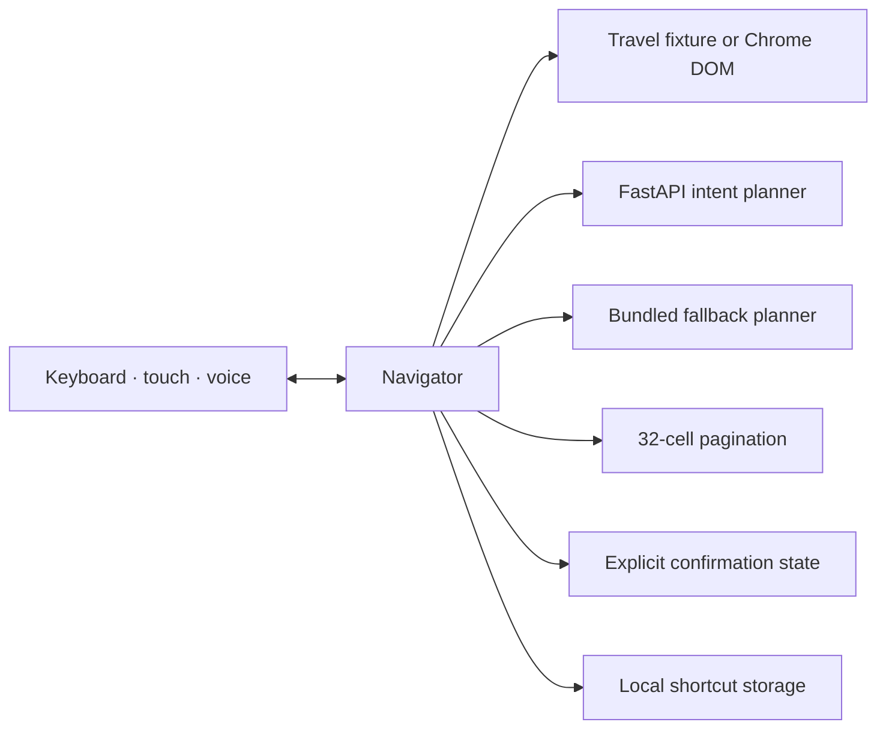

# Sparsh

**A web navigator for blind and low-vision people**

wHACKiest 2026 · Beyond the Browser · RV College of Engineering, Bengaluru

Blind people using screen readers can spend minutes moving through menus, filters and repeated results to answer a basic question. **Which flight is cheapest, and what will I actually pay?** The departure time and total fare may be several controls apart. At checkout, finding both again can interrupt the decision at the very moment the details matter most.

> **Find the fare. Check the details. Decide when to act.**

Sparsh turns a web page into an explorable map and puts the most important fact first on a **simulated 32-cell braille line**. Ask by voice or keyboard, compare the three cheapest flights, and review the exact fare before you confirm a simulated booking.

[Three-minute demo](#three-minutes-at-the-judging-table) · [Run locally](#try-the-mvp) · [Explore the architecture](#design)

## What Sparsh changes

| For a blind traveler | What the MVP demonstrates |
| --- | --- |
| **Get oriented.** Find the results without stepping through every control. | A spatial page map with labeled regions, keyboard navigation and spoken updates you can turn on. The Chrome side panel can capture landmarks from a real tab. |
| **Get the price first.** Compare options and revisit the exact fare at your own pace. | The travel demo ranks the three cheapest flights. The 32-cell line paginates the fare, airline and departure, with visible text alongside the braille. |
| **Stay in control.** Review the choice before committing. | Sparsh narrates the simulated checkout and waits at **Confirm** or **Cancel**. Six context buttons adapt as you go, and **My button** can replay a saved shortcut. |

## What ships for wHACKiest

A Chrome extension, a browser-based navigator and a modular FastAPI planner. The judge demo uses sample flights and a rules-based planner with a bundled fallback. It runs without an API key or braille hardware. The travel workflow demonstrates how page orientation, precise braille output and user approval can work together in one interface.

## Try the MVP

Requires Python 3.10 or later. Chrome supports the extension and is recommended for the optional microphone demo.

```sh
python -m venv .venv
```

Activate with `.venv\Scripts\Activate.ps1` on Windows PowerShell, or `source .venv/bin/activate` on macOS/Linux. Then run:

```sh
python -m pip install -r requirements.txt
python -m uvicorn backend.main:app --host 127.0.0.1 --port 8000
```

Open [the navigator](http://127.0.0.1:8000/navigator/) or [the planner API docs](http://127.0.0.1:8000/docs). For a service-free demo, serve the same navigator with `python -m http.server 8000 --bind 127.0.0.1 --directory extension` and open [the local preview](http://127.0.0.1:8000/). The navigator will use its bundled planner. Use one server at a time.

### Three minutes at the judging table

| Try this | Look for this |
| --- | --- |
| Hover over, tap, or tab to **Results**. Press **Enter** or double-click. | The map describes the region and takes you to the ranked flight list. Arrow keys move between regions. |
| Type or say **Compare the three cheapest**. | IndiGo leads at ₹4,230. The six context buttons now let you browse the ranked options. |
| Run **Book the second one**. | The demo selects Air India Express at 11:05 for ₹4,580. The activity log records both steps and checkout pauses at **Confirm** or **Cancel**. **Next line** lets you review overflow. |
| Cancel, then say or type **Make a button that compares the cheapest flights**. | **My button** repeats the comparison and survives reload. |
| Enable **Speak updates** before repeating the demo. | Progress is spoken and the exact quote remains visible in text and simulated braille. |

### Explore a real tab

Open Chrome’s extension manager, enable **Developer mode**, choose **Load unpacked**, and select `extension/`. Open a regular web page, click the Sparsh toolbar icon, and choose **Read active tab**. Sparsh maps visible DOM landmarks and scrolls to the region you activate. The Chrome extension requires an explicit toolbar gesture to grant access to the current tab.

## Design



| Subsystem | Entry point | Contract |
| --- | --- | --- |
| Page source | [browser.js](extension/core/browser.js), [fixture.js](extension/core/fixture.js) | A page title plus labeled regions with text and normalized geometry |
| Planner | [planner.py](backend/planner.py), [planner.js](extension/core/planner.js) | A command and sample flights in, a typed intent or ranking out |
| Checkout | [checkout.js](extension/core/checkout.js) | Snapshot a quote, cancel it, or consume it once to return a demo receipt |
| Braille | [braille.js](extension/core/braille.js) | Text in, paginated text and Unicode cells out |
| Speech and shortcuts | [speech.js](extension/core/speech.js), [storage.js](extension/core/storage.js) | Browser speech events and a small local persistence adapter |
| Navigator | [app.js](extension/ui/app.js), [views.js](extension/ui/views.js) | Controller state, accessible HTML controls and a spatial map |

The prototype uses rules for planning and prioritizes the fare when writing a quote. The braille translator covers basic English letters, digits and selected punctuation. The prototype exercises a fictional checkout in memory. Real-tab support covers reading and scrolling by landmark. Page excerpts stay in the navigator, flight requests go to the local planner, and microphone processing depends on the browser. A screen reader can use the text equivalents, but assistive technology compatibility has yet to be tested with users.

The [project plan](Sparsh_Research_and_Project_Plan.md) describes the longer-term direction, including model-backed planning, standardized braille translation, additional languages and tactile hardware.

## Verify locally

Run `npm test` with Node.js 20 or later to check braille cell limits and checkout confirmation behavior.
